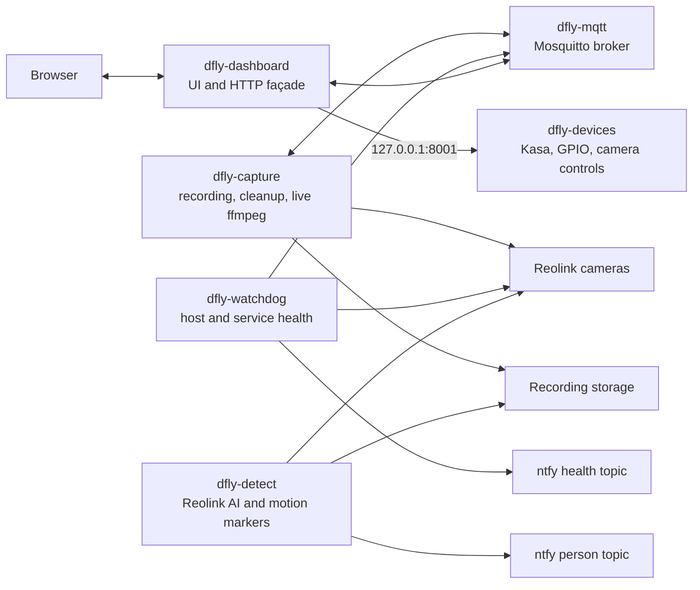

# Architecture

Dragonfly runs as independent services on the hub. Each service has one job and communicates through MQTT, a loopback-only HTTP API, shared recording files, or ntfy as described below. Services do not share in-process state.

## Services

- **`dfly-mqtt`** is a systemd alias to the package-managed Mosquitto service. It is the broker, not a second Dragonfly broker implementation.
- **`dfly-capture`** owns camera recording, segment cleanup, and on-demand live-stream ffmpeg. It publishes recording and heartbeat events over MQTT.
- **`dfly-watchdog`** independently checks camera reachability, storage, recording freshness, and the other service units. It publishes retained health state and its own heartbeat over MQTT, and sends Pi-health alerts. The dashboard marks the watchdog offline when its heartbeat becomes stale.
- **`dfly-detect`** polls camera events. Generic motion writes recording markers; Reolink AI people detections publish to the person ntfy topic.
- **`dfly-devices`** owns Kasa control, the scheduled shutoff, the GPIO button, and Reolink IR control. Its HTTP API binds only to `127.0.0.1:8001`.
- **`dfly-dashboard`** serves the UI, builds its registry from MQTT, serves capture's live HLS files, and proxies device actions to the loopback device API. It does not own watchdog, detection, or automation background loops.

The `dfly-mount-watchdog.timer` is a small systemd timer for repairing an unavailable recordings mount; it is an operational helper rather than another Dragonfly application service.

## Code Layout

- `src/dragonfly/common/` contains configuration, MQTT client, registry, alerts, RTSP parsing, system information, recording-path helpers, and shared constants.
- `src/dragonfly/services/dfly_capture/` contains capture, recorder, and live-stream implementation.
- `src/dragonfly/services/dfly_watchdog/` contains health checks and the watchdog runner.
- `src/dragonfly/services/dfly_detect/` contains camera event polling and detection runner.
- `src/dragonfly/services/dfly_devices/` contains device controllers, local API, and runner.
- `src/dragonfly/services/dfly_dashboard/` contains the dashboard app and runner.

The underscores in Python package folder names correspond to the hyphens used in systemd service names.

## Data Boundaries

MQTT topics use the `dragonfly/<module-id>/<event>` prefix. Capture and watchdog publish retained status; the dashboard subscribes and builds its own in-memory registry. The broker replays retained state when the dashboard reconnects.

The device API is strictly loopback-only. Browsers call the dashboard, which proxies switch and camera-control routes to `dfly-devices`; the device API is never exposed on the LAN or tailnet.

Capture writes live HLS output under `/tmp/dragonfly-live`. The dashboard serves those files, while MQTT carries live-start requests. Recordings and motion-marker sidecars stay on configured recording storage.

Health and camera-person notifications use different ntfy topics and separate alert managers. Neither ntfy topic is used as service-to-service transport.
